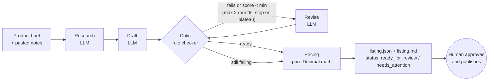

# marketplace-listing-agent

An LLM workflow that turns a product brief into a marketplace listing you can review: it reads your notes on competing listings, drafts titles, attributes, photo plan, description and buyer FAQ, critiques the draft against the marketplace rules, revises it, and prices it with the margin math shown line by line.

The pricing core is plain, exact, property-tested Python. The LLM writes; code checks and counts.

> Em português: agente que pesquisa, escreve, revisa e precifica anúncios de marketplace (pensado para regras no estilo do Mercado Livre), com a conta de margem exata e testada.

## Why

Writing a good listing is a loop: find the words buyers type, fit them into a short title, fill every attribute, say honestly what the product does not do, and pick a price that survives commission, fixed fees, shipping and tax. Each step is easy to get slightly wrong, and the price is the one where "slightly wrong" costs money on every sale.

This project splits that loop so each part is done by the right tool:

- an LLM for language (research summary, draft, revision);
- deterministic rules for quality (title length, forbidden words, contact info, keywords, attributes);
- exact decimal math for money.

Nothing is ever published. The output is a JSON and a Markdown file for a person to approve.

## Architecture



| Step | Who | Receives | Returns |
|---|---|---|---|
| Research | LLM | brief (no costs) + fenced, untrusted notes | `MarketResearch` (keywords, patterns, concerns, observed price range) |
| Draft | LLM | brief, research, rules | `ListingDraft` (titles, category, attributes, photos, description, FAQ) |
| Critic | code | draft, rules, keywords | `QualityReport` (findings, 0-100 score, passed, ready) |
| Revise | LLM | draft, findings, rules | `ListingDraft` |
| Pricing | code | costs, fee schedules, target margin | `PriceQuote` per listing type |

Every LLM answer is parsed into a Pydantic model. Invalid output or a provider error is retried once with the error appended to the prompt, then the step fails with a clear message. Each call is logged with step, attempt, latency and a shared trace id.

Providers: `fake` (deterministic, default), `anthropic` (Claude through the official SDK, `ANTHROPIC_API_KEY`) and `openai` (optional, `OPENAI_API_KEY`).

```
src/listing_agent/
  pricing.py      fee tiers, breakdown, price for a target margin, quotes, scenarios
  money.py        Decimal rounding and "charm" prices (x.90)
  rules.py        listing checker and score
  models.py       contracts between steps (what the LLM must return)
  prompts.py      prompt builders; untrusted notes are fenced as data
  pipeline.py     the workflow, retries, critique loop, step log
  providers/      fake, anthropic, openai behind one small protocol
  render.py       text tables and the Markdown listing
  cli.py          Typer commands: price, scenarios, check, run
config/marketplace.example.toml   rules + fee schedules (placeholders, see below)
examples/                         a fictional product brief and research notes
agents/marketplace-seller.md      Claude Code subagent that drives the CLI
```

## Quick start

```bash
python -m venv .venv && source .venv/bin/activate   # Windows: .venv\Scripts\activate
pip install -e ".[dev]"
listing-agent run examples/ceramic-mug.toml          # fake provider, no API key needed
```

With Claude:

```bash
pip install -e ".[anthropic]"
export ANTHROPIC_API_KEY=...        # see .env.example
listing-agent run examples/ceramic-mug.toml --provider anthropic --out out/
```

## Example run (fake provider, real output)

The fake provider packs every keyword into its first title on purpose, so the run shows the critic catching it and the revision fixing it.

```text
$ listing-agent run examples/ceramic-mug.toml --out out
Trace 02d63a22ac8d493e9553b8486908f0e8  provider=fake  status=ready_for_review

  research  attempt 1  ok  0 ms
  draft     attempt 1  ok  0 ms
  revise    attempt 1  ok  1 ms

Critique loop:
  round 0: score 70, 1 error(s), 0 warning(s)
  round 1: score 100, 0 error(s), 0 warning(s)

Titles:
  (53) Ceramic mug coffee mug 350 ml handmade stoneware gift
  (53) Ceramic mug 350 ml handmade stoneware gift coffee mug
  (53) Ceramic mug handmade stoneware gift coffee mug 350 ml

Quality score: 100/100 (ready)
Keyword coverage: 100%  Attribute completeness: 100%

| type    | point       | price | commission | fixed fee | shipping | tax  | cost  | profit | margin |
|---------|-------------|-------|------------|-----------|----------|------|-------|--------|--------|
| classic | breakeven   | 45.74 |       5.49 |      6.50 |     0.00 | 2.74 | 31.00 |   0.01 |   0.0% |
| classic | target      | 60.89 |       7.31 |      6.75 |     0.00 | 3.65 | 31.00 |  12.18 |  20.0% |
| classic | recommended | 60.90 |       7.31 |      6.75 |     0.00 | 3.65 | 31.00 |  12.19 |  20.0% |
| premium | breakeven   | 48.71 |       8.28 |      6.50 |     0.00 | 2.92 | 31.00 |   0.01 |   0.0% |
| premium | target      | 66.23 |      11.26 |      6.75 |     0.00 | 3.97 | 31.00 |  13.25 |  20.0% |
| premium | recommended | 66.90 |      11.37 |      6.75 |     0.00 | 4.01 | 31.00 |  13.76 |  20.6% |

Wrote out\listing.json and out\listing.md
```

`listing.md` holds the titles with character counts, the attribute table, the photo plan, the description ready to paste (including a "What it does not do" section), the buyer FAQ, the quality report and the price table. `listing-agent check out/listing.json` re-checks it after you edit it by hand.

## Pricing

For a price `p` in a fee tier:

```
profit = p - p*commission% - fixed_fee - shipping - p*tax% - unit_cost
margin = profit / p
```

Fee tiers and the free-shipping threshold make profit piecewise linear. Inside each segment the margin is `keep - constant/p`, which only grows with `p`, so the lowest price for a target margin has a closed form per segment: `p = constant / (1 - commission% - tax% - target)`. The solver takes the lowest valid candidate across segments. No search loop, no floats, no iteration cap.

### The free-shipping dead zone

Same mug (cost 31.00, seller-paid shipping 21.90 from 79.00, tax 6%), classic listing:

```text
$ listing-agent scenarios --cost 31 --shipping 21.90 --tax-rate 0.06 --type classic \
    --price 59.90 --price 78.90 --price 80.90 --price 97.90 --price 119.90
| type    | price  | commission | fixed fee | shipping | tax  | cost  | profit | margin |
|---------|--------|------------|-----------|----------|------|-------|--------|--------|
| classic |  59.90 |       7.19 |      6.75 |     0.00 | 3.59 | 31.00 |  11.37 |  19.0% |
| classic |  78.90 |       9.47 |      6.75 |     0.00 | 4.73 | 31.00 |  26.95 |  34.2% |
| classic |  80.90 |       9.71 |      0.00 |    21.90 | 4.85 | 31.00 |  13.44 |  16.6% |
| classic |  97.90 |      11.75 |      0.00 |    21.90 | 5.87 | 31.00 |  27.38 |  28.0% |
| classic | 119.90 |      14.39 |      0.00 |    21.90 | 7.19 | 31.00 |  45.42 |  37.9% |
```

Going from 78.90 to 80.90 cuts profit from 26.95 to 13.44, and it takes about 97.90 to earn back what 78.90 already made. The solver knows this: when the target does not fit under the threshold, it jumps straight past the dead zone.

```text
$ listing-agent price --cost 45 --shipping 21.90 --tax-rate 0.06 --margin 0.20 --type classic
| type    | point       | price  | commission | fixed fee | shipping | tax  | cost  | profit | margin |
|---------|-------------|--------|------------|-----------|----------|------|-------|--------|--------|
| classic | breakeven   |  63.11 |       7.57 |      6.75 |     0.00 | 3.79 | 45.00 |   0.00 |   0.0% |
| classic | target      | 107.91 |      12.95 |      0.00 |    21.90 | 6.47 | 45.00 |  21.59 |  20.0% |
| classic | recommended | 108.90 |      13.07 |      0.00 |    21.90 | 6.53 | 45.00 |  22.40 |  20.6% |

Required price by target margin:
| type    | margin 0.0% | margin 10.0% | margin 20.0% | margin 30.0% |
|---------|-------------|--------------|--------------|--------------|
| classic |       63.11 |        71.88 |       107.91 |       128.66 |
```

`--monthly-fixed 300` adds how many sales a month cover fixed costs such as ads or tools (25 sales at 60.90 for the mug).

### About the fee numbers

`config/marketplace.example.toml` has **illustrative placeholders** shaped like a common marketplace fee table: a percentage per sale, a fixed fee per unit on cheaper items, and seller-paid shipping above a threshold. They are not the official fees of any marketplace. Fees change often and vary by category, so put the numbers from your own seller dashboard in a copy of that file and pass it with `--config`.

## Listing rules

`rules.py` checks every title, the description and the FAQ answers:

| Rule | Severity | Notes |
|---|---|---|
| Title length | error | configurable, 60 by default |
| Forbidden words in titles | error | whole word, accent and case insensitive |
| Contact info anywhere | error | e-mail, link, phone, social handle, messaging app |
| All-caps title | warning | |
| Keyword coverage | warning | below the configured share of research keywords |
| Missing attribute | warning | required list from the config |
| Short description | warning | |

Score = 30% titles + 25% keyword coverage + 25% attribute completeness + 20% description. `passed` means no errors; `ready` means passed and score at or above `min_score`.

## Design decisions

- **The critic is code, not a second LLM.** A model grading its own draft shares its blind spots and drifts between runs. Rules are cheap, instant and give the same answer twice, which also makes the revise loop testable. The labeled cases in `tests/test_rules.py` act as the critic's eval set.
- **The LLM never does arithmetic.** It never even sees the costs. Prices come from `pricing.py`, which uses `Decimal` end to end and rounds up so a computed minimum is never undercut.
- **Closed-form pricing instead of search.** Because the margin is monotonic inside each fee segment, the solver is exact and has no step size or iteration limit to tune. Hypothesis checks that the result meets the target and that no cheaper cent does.
- **Bounded loop with a plateau stop.** At most two revisions, and the loop stops early if a revision does not improve the score. Anything still failing is marked `needs_attention` instead of being retried forever.
- **Untrusted input stays data.** Notes copied from competitor pages are fenced in a tagged block and the system prompt says to ignore instructions in them. Structured output is the second guard, and the contact-info rule is the third: the example notes include a prompt-injection line that tries to add a phone number to every title.
- **No scraping.** Marketplaces block automated reading and it is against their terms. The research step works on notes you collect yourself.
- **Small provider protocol.** One method, `complete(request, schema) -> model`. The Anthropic provider uses the SDK's `messages.parse` with the Pydantic schema; the OpenAI one uses `responses.parse`. The fake provider reads the structured payload instead of the prompt, which keeps it deterministic.
- **Human in the loop by construction.** The tool writes files. Publishing, answering buyers and choosing the final price stay with the seller.

## Development

```bash
pip install -e ".[dev]"
ruff check . && ruff format --check .
mypy                      # strict, src and tests
pytest                    # 137 tests, 100% line and branch coverage
```

CI runs the same commands on every push and pull request (`.github/workflows/ci.yml`).

## Claude Code subagent

`agents/marketplace-seller.md` is a subagent definition that drives this CLI: it asks for the brief, runs the workflow, explains the price table and never publishes. Copy it to `.claude/agents/` in a project where the package is installed.

## License

MIT, see [LICENSE](LICENSE).
